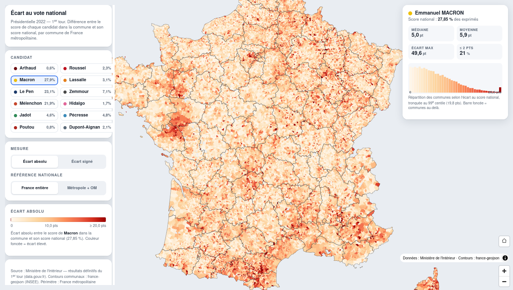
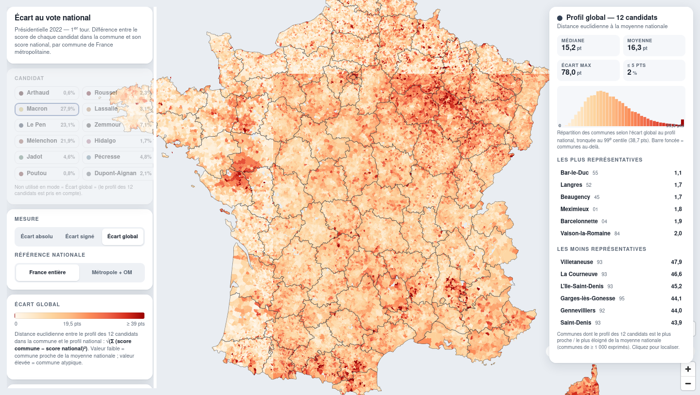

# Écart au vote national — Présidentielle 2022 (1er tour)

Page web interactive : une carte choroplèthe par **commune de France métropolitaine**
montrant l'**écart absolu** entre le score de chaque candidat dans la commune et son
**score national**, ainsi qu'un **écart global** de représentativité (distance du profil
des 12 candidats à la moyenne nationale).




## Utilisation

Ouvrez simplement `index.html` dans un navigateur récent (double‑clic).

- La page fonctionne **hors ligne** : les données et la bibliothèque cartographique
  sont embarquées dans le dossier.
- Aucun serveur n'est nécessaire. Si vous préférez en servir un :
  `python3 -m http.server` puis <http://localhost:8000/>.

### Contrôles

| Contrôle | Effet |
|---|---|
| **Candidat** | sélectionne l'un des 12 candidats ; la carte, la légende et les statistiques se mettent à jour. |
| **Mesure → Écart absolu** | colorie les communes selon `\|score commune − score national\|` (réglage par défaut). |
| **Mesure → Écart signé** | échelle divergente : bleu = sous le score national, rouge = au‑dessus. |
| **Mesure → Écart global** | colorie chaque commune selon sa distance au **profil national** sur les 12 candidats, `√(Σ (score commune − score national)²)`. Le sélecteur de candidat n'est alors pas utilisé. |
| **Référence nationale** | `France entière` (résultats officiels) ou `Métropole + OM` (agrégat du jeu de données). |
| **Survol d'une commune** | infobulle : nom, département, exprimés, score du candidat, score national, écart. |
| Boutons +/− et 🏠 | zoom et recentrage. |

### Écart global (représentativité)

Le mode « Écart global » mesure à quel point le **profil politique** d'une commune
(ses 12 scores) s'écarte du profil national :

```
écart global = √( Σ_candidats (score_commune − score_national)² )
```

- valeur **faible** → commune proche de la moyenne nationale (la plus « représentative ») ;
- valeur **élevée** → commune atypique.

Le panneau de droite classe alors les communes les plus et les moins représentatives
(communes de ≥ 1 000 exprimés, pour écarter le bruit des très petites communes) ;
un clic recentre la carte sur la commune.

Avec la référence *France entière* : les plus représentatives sont Bar‑le‑Duc (1,1),
Langres (1,7), Beaugency (1,7)… ; les moins représentatives Villetaneuse (47,9),
La Courneuve (46,6), Saint‑Denis (43,9)…

## Données

- **Résultats** : `resultats-par-niveau-subcom-t1-france-entiere.xlsx`
  (Ministère de l'Intérieur — résultats définitifs du 1er tour, data.gouv.fr).
  Le fichier couvre la métropole **et** l'outre‑mer (codes `ZA`…`ZX`), mais **pas**
  les Français de l'étranger.
- **Contours communaux** : [france-geojson](https://github.com/gregoiredavid/france-geojson) (codes INSEE).
- **Scores nationaux de référence** (France entière, Conseil constitutionnel) :

  | Candidat | % | Candidat | % |
  |---|---:|---|---:|
  | Arthaud | 0,56 | Mélenchon | 21,95 |
  | Roussel | 2,28 | Hidalgo | 1,74 |
  | Macron | 27,85 | Jadot | 4,63 |
  | Lassalle | 3,13 | Pécresse | 4,78 |
  | Le Pen | 23,15 | Poutou | 0,76 |
  | Zemmour | 7,07 | Dupont-Aignan | 2,06 |

### Périmètre

- **France métropolitaine uniquement** : 34 782 communes représentées sur les
  35 035 du fichier source. Les 217 communes d'outre‑mer et les Français de
  l'étranger ne figurent pas sur la carte (choix de lisibilité).
- Le score d'un candidat dans une commune = *voix du candidat / suffrages exprimés*
  de la commune.
- L'échelle de couleur est **adaptative par candidat** : elle est tronquée au
  99ᵉ centile des écarts (les communes au‑delà sont en couleur maximale), afin de
  ne pas être écrasée par les très petites communes.

## Fichiers

```
index.html                 page (structure + styles)
app.js                     logique : chargement, carte MapLibre, couleurs, infobulles
data/communes.js           géométries + scores, compressés (gzip/base64)
vendor/maplibre-gl.js|css  bibliothèque cartographique (MapLibre GL JS 5.24.1, corrigée de CVE-2026-85061)
resultats-...xlsx          fichier source
```

## Méthode de construction des données

1. Lecture du `.xlsx` (openpyxl) → pour chaque commune : code INSEE, nom, exprimés,
   et le score (% des exprimés) des 12 candidats.
2. Jonction avec les contours communaux par code INSEE ; simplification légère et
   arrondi des coordonnées (~110 m).
3. Compression gzip puis encodage base64 de l'ensemble `{communes, départements}`
   dans `data/communes.js` ; le navigateur décompresse via `DecompressionStream`.

Le score national « France entière » est celui proclamé par le Conseil
constitutionnel ; l'option `Métropole + OM` recalcule la moyenne sur le périmètre
du jeu de données (métropole + outre‑mer).
